# 网络工程师 GitOps 自动化运维学习手册

> 从零基础到进阶实战：网络自动化、基础设施即代码、GitOps、CI/CD、配置合规与持续交付  
> 适用对象：传统网络工程师、网络运维工程师、希望转向 NetDevOps / NetOps 的 IT 从业者  
> 建议实验环境：Linux 虚拟机 + Git + Python + Ansible；进阶可加入 Containerlab、NetBox、GitLab CI  
> 注意：所有设备变更请先在自有实验环境中验证。生产环境应执行变更审批、备份、分批发布和回滚预案。
> **图示说明：** 文中的流程图使用 Mermaid 绘制。推荐使用 GitHub、GitLab、Obsidian 或支持 Mermaid 的 Markdown 编辑器阅读；若预览器不支持 Mermaid，可将图表代码粘贴到 <https://mermaid.live/> 导出 SVG / PNG。

---

## 目录

1. [学习目标与路线图](#1-学习目标与路线图)
2. [GitOps 基础概念](#2-gitops-基础概念)
3. [实验环境搭建](#3-实验环境搭建)
4. [第 1 阶段：Linux、Git 与 Python 基础](#4-第-1-阶段linuxgit-与-python-基础)
5. [第 2 阶段：Ansible 网络自动化入门](#5-第-2-阶段ansible-网络自动化入门)
6. [第 3 阶段：配置模板与数据驱动](#6-第-3-阶段配置模板与数据驱动)
7. [第 4 阶段：Git 工作流与 CI 检查](#7-第-4-阶段git-工作流与-ci-检查)
8. [第 5 阶段：构建一个可运行的 NetDevOps 项目](#8-第-5-阶段构建一个可运行的-netdevops-项目)
9. [第 6 阶段：模拟拓扑与自动化测试](#9-第-6-阶段模拟拓扑与自动化测试)
10. [第 7 阶段：NetBox、Nornir、NAPALM 与 API](#10-第-7-阶段netboxnornirnapalm-与-api)
11. [第 8 阶段：生产级 GitOps 流程设计](#11-第-8-阶段生产级-gitops-流程设计)
12. [安全、回滚与故障排查](#12-安全回滚与故障排查)
13. [互联网公开项目与代码入口](#13-互联网公开项目与代码入口)
14. [毕业实战项目](#14-毕业实战项目)
15. [常用命令速查](#15-常用命令速查)

---

## 1. 学习目标与路线图

### 学习路线总览图

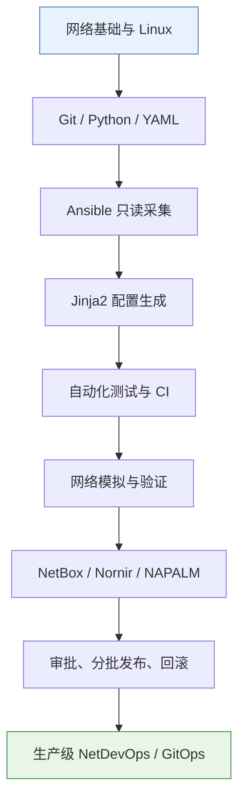

建议把每个阶段都做成一个小项目，而不是只看视频或阅读文档。每完成一阶段，就把代码、实验结果和故障复盘提交到自己的 Git 仓库。


完成学习后，应该能够：

- 使用 Git 管理网络配置、变更申请和审计历史。
- 使用 Python 读取 YAML / JSON、调用 API、生成报告。
- 使用 Ansible 对网络设备批量采集信息、渲染配置和执行受控变更。
- 用 Jinja2 模板与数据文件分离“配置意图”和“命令文本”。
- 建立 CI 流水线，对数据格式、模板、策略和配置差异进行自动检查。
- 在模拟拓扑中测试 VLAN、接口、路由与连通性变更。
- 使用 NetBox 维护网络事实数据，并探索 Nornir、NAPALM 等工具。
- 设计审批、分批发布、变更验证、失败停止和回滚流程。

### 推荐学习计划

| 阶段 | 内容 | 建议时间 | 阶段成果 |
|---|---|---:|---|
| 0 | Linux、SSH、网络基础复习 | 1 周 | 能管理 Linux 实验机 |
| 1 | Git、Python、YAML、JSON | 1–2 周 | 能编写数据检查脚本 |
| 2 | Ansible 基础 | 1–2 周 | 能批量采集设备信息 |
| 3 | Jinja2、配置意图、差异检查 | 1–2 周 | 能从数据生成配置 |
| 4 | Git 分支、MR、CI | 1 周 | 能自动检查提交 |
| 5 | 网络模拟、验证与回滚 | 2 周 | 完成 VLAN / 接口变更实验 |
| 6 | NetBox、Nornir、NAPALM、API | 2–4 周 | 构建可扩展自动化项目 |
| 7 | 生产级流程与安全治理 | 持续实践 | 形成可审计的交付流程 |

### 学习顺序建议

先学 **Git + Python + Ansible**，不要一开始就同时部署 Kubernetes、Terraform、NetBox、Nornir、GitLab Runner 等全部组件。先完成一个可验证、可回退的小项目，再逐步增加组件。

---

## 2. GitOps 基础概念

### GitOps 的闭环示意图

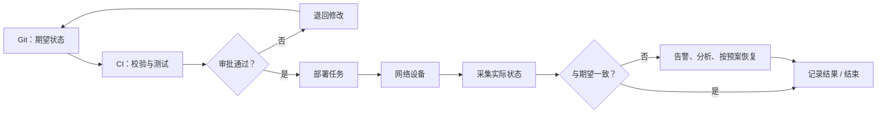

### 传统运维与 GitOps 对比


### 2.1 期望状态与实际状态

- **期望状态（Desired State）**：Git 仓库中声明的目标配置，例如某个 VLAN 应存在、某个接口应属于指定 VLAN。
- **实际状态（Actual State）**：从交换机、路由器、防火墙或 API 读取到的现状。
- **差异（Drift）**：实际状态偏离期望状态，例如有人手工删除 VLAN。
- **协调 / 修正（Reconciliation）**：检测差异，并按策略告警、生成变更或自动恢复。

在传统网络设备上，不一定能直接做到全自动持续协调。更常见的安全流程是：

1. Git 提交代表变更意图。
2. CI 进行语法、数据、策略和测试检查。
3. 人工审批变更。
4. 自动化系统先备份并生成差异。
5. 对少量设备执行变更。
6. 读取设备状态并进行业务验证。
7. 成功后扩大范围；失败则停止并按预案恢复。

### 2.2 GitOps 与 IaC、自动化的区别

| 名称 | 关注点 | 示例 |
|---|---|---|
| 网络自动化 | 减少手工操作 | Python 批量采集接口状态 |
| IaC（基础设施即代码） | 用代码 / 数据描述基础设施 | Terraform 管理云网络资源 |
| CI/CD | 自动检查、测试、发布 | GitLab CI 在合并后运行 Ansible |
| GitOps | Git 作为期望状态来源，并围绕差异、审查和协调形成闭环 | 提交 VLAN 数据后自动检查、审批、部署、验证 |

GitOps 不等于“每次 push 就直接向所有生产设备下发配置”。生产环境必须将审批、权限、影响范围和回滚纳入设计。

### 2.3 网络工程师应掌握的关键数据

- 设备：名称、管理地址、厂商、型号、操作系统版本、角色、站点。
- 接口：名称、描述、模式、速率、MTU、接入 VLAN、Trunk VLAN。
- 二层：VLAN、STP、LACP、MAC 学习状态。
- 三层：VRF、接口地址、静态路由、OSPF / BGP 邻居。
- 安全：管理面 ACL、AAA、SNMPv3、SSH、配置备份和凭据管理。
- 服务：DNS、DHCP、NTP、Syslog、Telemetry。
- 变更：申请人、审查人、时间窗口、影响范围、验证项、回滚计划。

---

## 3. 实验环境搭建

### 实验环境组件图

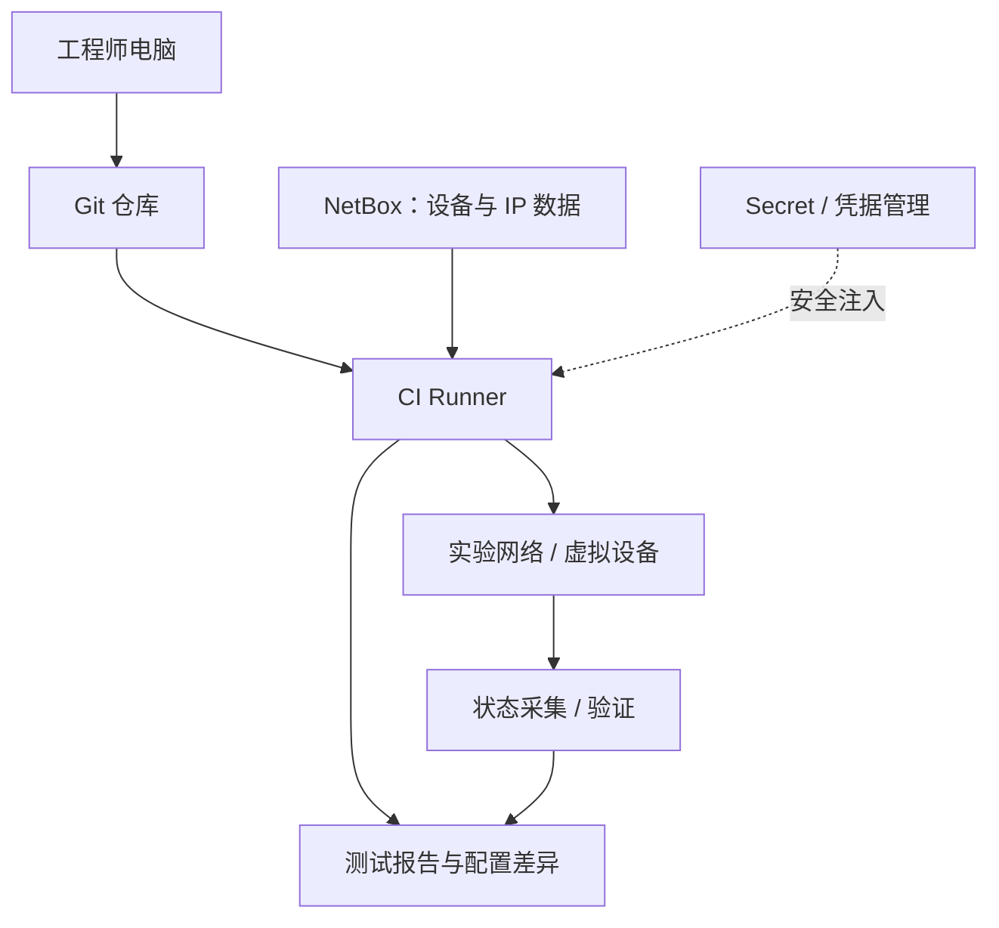

### 建议的初学者实验拓扑

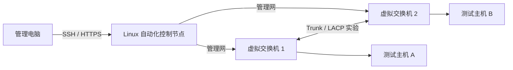

该图是逻辑拓扑，不代表具体产品端口或接口编号。初期可用 mock 数据测试脚本，后续再连接真实虚拟设备。


### 3.1 最小环境

一台 Debian 12 / Ubuntu 22.04+ Linux 虚拟机即可。建议 2 vCPU、4 GB RAM、20 GB 磁盘起步。后续运行网络容器或 NetBox 时可增加资源。

安装基础工具：

```bash
sudo apt update
sudo apt install -y git python3 python3-venv python3-pip \
  openssh-client curl jq make
```

建立工作目录：

```bash
mkdir -p ~/netdevops-lab
cd ~/netdevops-lab
git init
python3 -m venv .venv
source .venv/bin/activate
python -m pip install --upgrade pip
```

创建 `.gitignore`：

```gitignore
.venv/
__pycache__/
*.py[cod]
.env
.env.*
!.env.example
secrets/
*.log
reports/private/
```

### 3.2 安装常用 Python 包

```bash
pip install pyyaml jinja2
pip freeze > requirements.txt
```

项目中应固定并审查依赖版本。团队项目可用锁定文件或受控依赖更新流程，避免构建结果随时间意外变化。

### 3.3 安装 Ansible

推荐在虚拟环境中安装：

```bash
pip install ansible
ansible --version
ansible-galaxy collection install ansible.netcommon
```

厂商设备通常还需要相应 collection 与 Python 库。请根据设备平台查阅官方文档，确认模块、连接插件和依赖支持情况。不同厂商和 OS 版本的命令、模块支持可能不同。

### 3.4 连接安全

- 首先使用实验设备、虚拟设备或只读账号。
- 不要把密码、私钥、Token 放进 Git。
- 生产凭据使用 Ansible Vault、CI Secret、Vault 类密钥管理系统或受控凭据平台。
- 不要为了省事关闭 SSH 主机密钥检查；实验环境可维护自己的 `known_hosts`。
- 网络自动化账号应按最小权限原则授权。

---

## 4. 第 1 阶段：Linux、Git 与 Python 基础

### 一次配置变更的 Git 流程

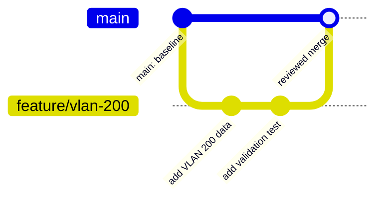

学习重点：Git 保存的是变更历史与意图，不会自动把设备恢复到某个 commit 对应的配置。设备侧执行和回滚需要单独设计。


### 4.1 Git 常用命令

```bash
git status
git add .
git commit -m "docs: add initial network automation lab"
git log --oneline --graph --decorate
git diff
git diff --staged
git switch -c feature/add-vlan-200
```

推荐分支流程：

1. 从 `main` 创建功能分支。
2. 修改 YAML / 模板 / 文档。
3. 本地执行测试。
4. 提交并推送。
5. 创建 Pull Request / Merge Request。
6. CI 检查通过、审核批准后合并。
7. 由受控发布任务部署到设备。

### 4.2 第一个 Python 数据检查脚本

创建 `check_yaml.py`：

```python
#!/usr/bin/env python3
from pathlib import Path
import sys
import yaml

def main() -> int:
    path = Path(sys.argv[1] if len(sys.argv) > 1 else "data/site.yml")
    try:
        data = yaml.safe_load(path.read_text(encoding="utf-8"))
    except FileNotFoundError:
        print(f"ERROR: file not found: {path}")
        return 2
    except yaml.YAMLError as exc:
        print(f"ERROR: invalid YAML: {exc}")
        return 2

    if not isinstance(data, dict):
        print("ERROR: top-level YAML value must be a mapping")
        return 2

    devices = data.get("devices", [])
    if not isinstance(devices, list):
        print("ERROR: 'devices' must be a list")
        return 2

    seen = set()
    errors = []
    for index, device in enumerate(devices):
        if not isinstance(device, dict):
            errors.append(f"devices[{index}] must be a mapping")
            continue

        name = device.get("name")
        if not isinstance(name, str) or not name.strip():
            errors.append(f"devices[{index}] is missing a valid name")
            continue

        if name in seen:
            errors.append(f"duplicate device name: {name}")
        seen.add(name)

        if not device.get("platform"):
            errors.append(f"{name}: missing platform")
        if not device.get("host"):
            errors.append(f"{name}: missing host")

    if errors:
        print("\n".join(f"ERROR: {error}" for error in errors))
        return 1

    print(f"OK: validated {len(devices)} device(s) in {path}")
    return 0

if __name__ == "__main__":
    raise SystemExit(main())
```

创建 `data/site.yml`：

```yaml
site: lab-shanghai
devices:
  - name: sw1
    platform: cisco_ios
    host: 192.0.2.11
  - name: sw2
    platform: cisco_ios
    host: 192.0.2.12
```

运行：

```bash
mkdir -p data
python check_yaml.py data/site.yml
```

预期结果：

```text
OK: validated 2 device(s) in data/site.yml
```

`192.0.2.0/24` 是文档示例地址段，不应直接当作真实设备管理地址。将示例平台替换成真实平台时，需同步修改自动化连接插件和模块。

### 4.3 练习

1. 在 `devices` 中添加第三台设备。
2. 故意写入重复名称，确认脚本能报错。
3. 删除一个设备的 `host`，确认脚本失败退出。
4. 将脚本和 YAML 文件提交到 Git。
5. 新建分支，修改站点名称，再用 `git diff` 检查差异。

---

## 5. 第 2 阶段：Ansible 网络自动化入门

### Ansible 执行链路

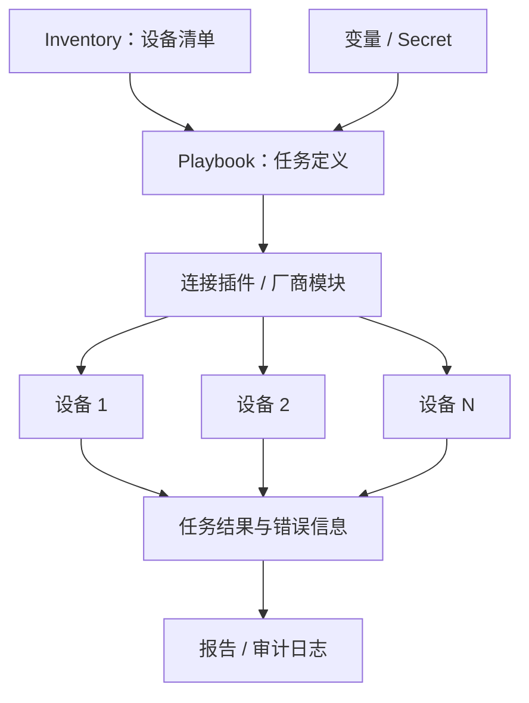

### 建议的学习顺序


### 5.1 目录结构

```text
netdevops-lab/
├── inventory/
│   └── lab.yml
├── playbooks/
│   └── collect.yml
├── data/
│   └── site.yml
├── check_yaml.py
└── requirements.txt
```

### 5.2 Inventory 示例

创建 `inventory/lab.yml`：

```yaml
all:
  children:
    lab_switches:
      hosts:
        sw1:
          ansible_host: 192.0.2.11
        sw2:
          ansible_host: 192.0.2.12
      vars:
        ansible_user: "{{ lookup('env', 'NETOPS_USER') }}"
        ansible_password: "{{ lookup('env', 'NETOPS_PASSWORD') }}"
        ansible_connection: ansible.netcommon.network_cli
        ansible_network_os: cisco.ios.ios
```

以上只是 Cisco IOS 风格示例。使用前应安装对应 collection，例如：

```bash
ansible-galaxy collection install cisco.ios
```

如果使用华为 VRP、H3C Comware 或其他平台，请查阅对应的官方 Ansible collection / 连接插件文档，不要把 `cisco.ios.ios` 原样套用到其他厂商。

凭据通过环境变量传入，而不是写在 inventory 里：

```bash
export NETOPS_USER='lab-automation'
read -rsp 'Password: ' NETOPS_PASSWORD
export NETOPS_PASSWORD
echo
```

实验结束后清除变量：

```bash
unset NETOPS_PASSWORD
```

### 5.3 先做连接测试

根据目标设备平台选择支持的模块。Cisco IOS 实验示例：

```bash
ansible lab_switches -i inventory/lab.yml \
  -m cisco.ios.ios_facts \
  -e gather_subset=min
```

若模块参数或执行方式因 Ansible collection 版本不同而有差异，请以当前安装版本的官方文档为准。先对单台设备测试，再扩大到设备组。

### 5.4 只读采集 Playbook

创建 `playbooks/collect.yml`：

```yaml
---
- name: Collect facts from lab switches
  hosts: lab_switches
  gather_facts: false

  tasks:
    - name: Gather IOS facts
      cisco.ios.ios_facts:
        gather_subset:
          - min

    - name: Print device identity
      ansible.builtin.debug:
        msg:
          - "Device: {{ inventory_hostname }}"
          - "Platform: {{ ansible_net_system | default('unknown') }}"
          - "Version: {{ ansible_net_version | default('unknown') }}"
          - "Model: {{ ansible_net_model | default('unknown') }}"
```

执行：

```bash
ansible-playbook -i inventory/lab.yml playbooks/collect.yml
```

先从只读采集开始。理解 inventory、变量优先级、facts、任务执行结果和错误处理之后，再做配置变更。

### 5.5 Ansible 练习清单

- [ ] 只对一台设备采集 facts。
- [ ] 将目标限制为 `--limit sw1`。
- [ ] 使用 `--check --diff` 预览支持 check mode 的任务。
- [ ] 为每次运行保存日志与执行结果。
- [ ] 练习失败时停止发布，不要忽略关键错误。

> `--check` 并非所有网络模块都完整支持；它不保证能准确模拟设备最终状态。必须结合模块文档和真实实验验证。

---

## 6. 第 3 阶段：配置模板与数据驱动

### 数据、模板与设备的关系

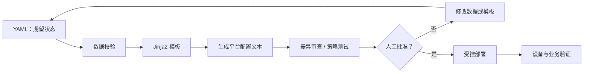

### 示例：VLAN 意图如何变成配置

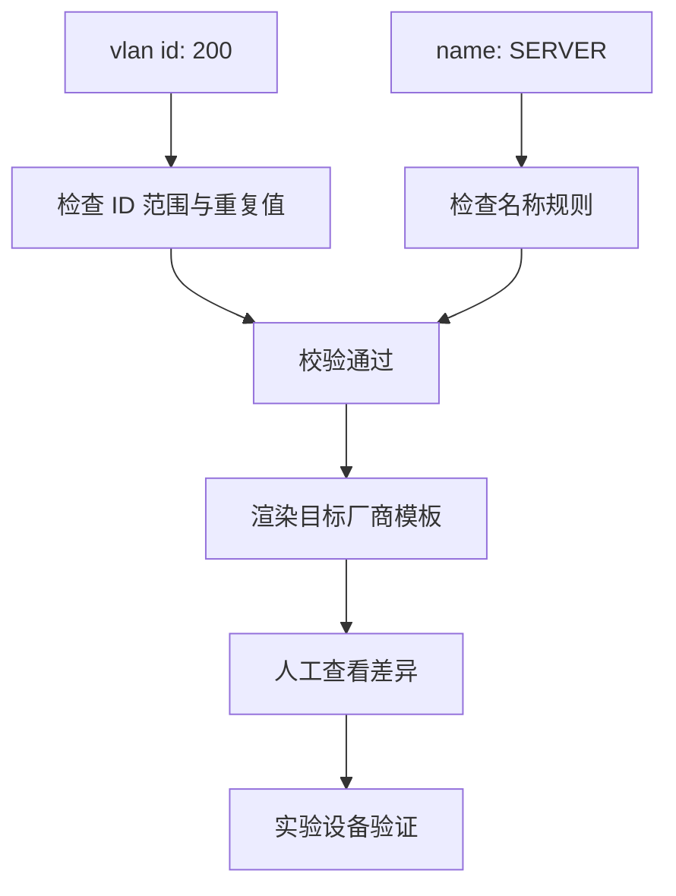


### 6.1 为什么分离数据与模板

不要把设备信息、业务参数和配置命令混在一个巨大脚本里。推荐分为：

- `data/`：设备、VLAN、接口、地址等期望状态。
- `templates/`：平台对应的 Jinja2 模板。
- `scripts/`：检查、生成和报告脚本。
- `playbooks/`：采集、部署、验证任务。
- `tests/`：单元测试与策略测试。

### 6.2 VLAN 数据文件

创建 `data/vlans.yml`：

```yaml
vlans:
  - id: 100
    name: OFFICE
  - id: 200
    name: SERVER
  - id: 300
    name: GUEST
```

### 6.3 Jinja2 模板

创建 `templates/vlans_ios.j2`：

```jinja2

vlan {{ vlan.id }}
 name {{ vlan.name }}

```

创建 `render_vlans.py`：

```python
from pathlib import Path
import yaml
from jinja2 import Environment, FileSystemLoader, StrictUndefined

root = Path(__file__).parent
data = yaml.safe_load((root / "data/vlans.yml").read_text(encoding="utf-8"))

ids = [item["id"] for item in data["vlans"]]
if len(ids) != len(set(ids)):
    raise SystemExit("ERROR: duplicate VLAN ID")

for item in data["vlans"]:
    if not isinstance(item["id"], int) or not 1 <= item["id"] <= 4094:
        raise SystemExit(f"ERROR: invalid VLAN ID: {item['id']}")
    if not item["name"] or any(ch.isspace() for ch in item["name"]):
        raise SystemExit(f"ERROR: invalid VLAN name: {item['name']!r}")

env = Environment(
    loader=FileSystemLoader(root / "templates"),
    undefined=StrictUndefined,
    trim_blocks=True,
    lstrip_blocks=True,
)
template = env.get_template("vlans_ios.j2")
output = template.render(**data)
print(output)
```

运行：

```bash
python render_vlans.py
```

预期输出类似：

```text
vlan 100
 name OFFICE
vlan 200
 name SERVER
vlan 300
 name GUEST
```

该输出是 Cisco IOS 风格的示例配置，并不保证可直接用于其他厂商。真实部署前需要验证目标平台的语法、配置模式、命令幂等性及回滚方式。

### 6.4 进阶：生成文件并做差异检查

```bash
python render_vlans.py > build-vlans.txt
git diff -- build-vlans.txt
```

建议不要只检查“脚本能否生成文本”，还要检查：

1. VLAN ID 是否重复、越界。
2. 名称是否符合平台规则。
3. 是否误删除现网已有 VLAN。
4. 变更影响哪些设备、接口和业务。
5. 目标设备的配置差异是否符合预期。
6. 是否具备恢复原配置的方案。

---

## 7. 第 4 阶段：Git 工作流与 CI 检查

### CI 流水线流程图

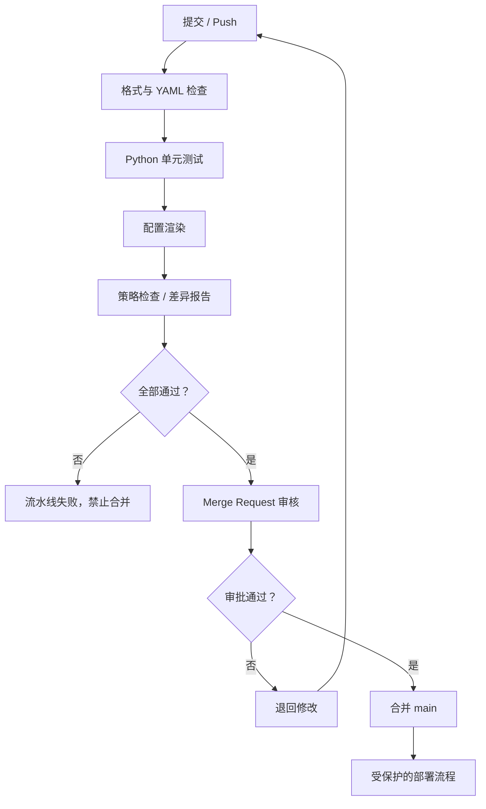

### 验证阶段与生产发布阶段必须分离

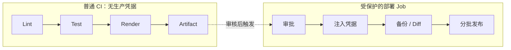


### 7.1 分支和审批流程

```text
feature 分支
   │
   ├── YAML / Python / 模板检查
   ├── 单元测试与策略检查
   ├── 生成配置差异
   ▼
Pull Request / Merge Request
   │
   ├── 自动检查通过
   ├── 网络负责人审核
   └── 变更审批
   ▼
合并到 main
   │
   ▼
受控发布任务
   │
   ├── 备份
   ├── 小批量部署
   ├── 设备状态验证
   └── 业务验证 / 停止 / 回滚
```

### 7.2 GitLab CI 示例

创建 `.gitlab-ci.yml`：

```yaml
stages:
  - validate
  - test
  - render

default:
  image: python:3.12-slim

before_script:
  - python -m pip install --no-cache-dir pyyaml jinja2

validate_yaml:
  stage: validate
  script:
    - python check_yaml.py data/site.yml
    - python -c "import yaml; yaml.safe_load(open('data/vlans.yml', encoding='utf-8'))"

test_templates:
  stage: test
  script:
    - python -m compileall -q .
    - python render_vlans.py > /tmp/rendered-vlans.txt
    - grep -q "vlan 100" /tmp/rendered-vlans.txt
    - grep -q "vlan 200" /tmp/rendered-vlans.txt
    - grep -q "vlan 300" /tmp/rendered-vlans.txt

render_config:
  stage: render
  script:
    - python render_vlans.py > rendered-vlans.txt
  artifacts:
    paths:
      - rendered-vlans.txt
    expire_in: 7 days
```

注意：

- 该流水线只做数据检查和配置渲染，不会登录或修改网络设备。
- `before_script` 安装依赖适合入门演示；团队环境建议使用固定版本和受控基础镜像。
- 不要在普通验证 Job 中暴露生产凭据。
- 部署 Job 应独立设置环境保护、人工审批、限定分支和 Runner 权限。
- GitLab CI 配置语法会随版本变化，使用时请以所部署 GitLab 版本文档为准。

### 7.3 本地模拟 CI

```bash
python check_yaml.py data/site.yml
python render_vlans.py > /tmp/vlans.txt
grep -q 'vlan 200' /tmp/vlans.txt
```

把这几条命令放进 CI 后，每次提交都能自动运行基础检查。

---

## 8. 第 5 阶段：构建一个可运行的 NetDevOps 项目

### 项目目录职责图

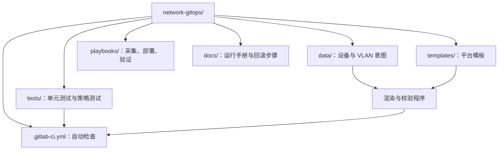

### 从提交到可审计交付

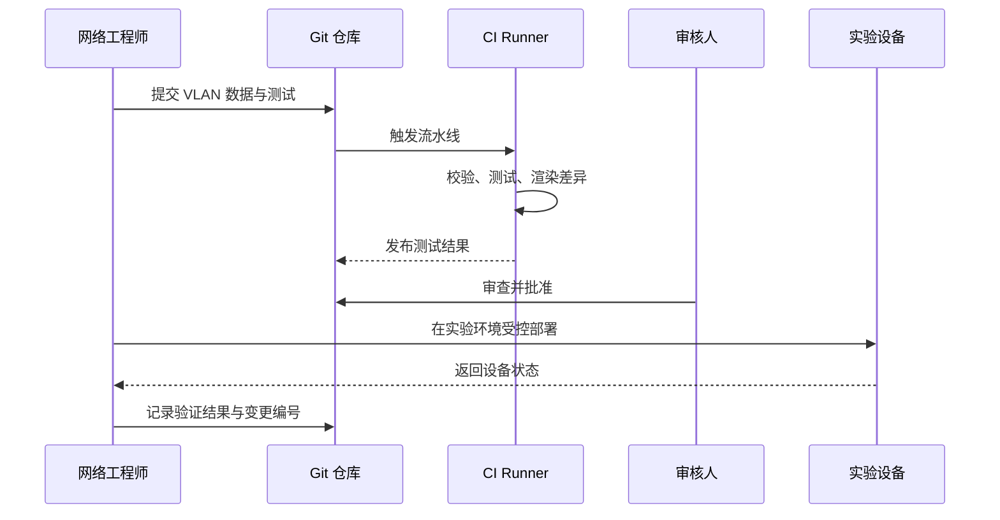


本项目实现：**设备清单校验 → VLAN 数据校验 → 配置渲染 → CI 自动测试 → 人工审核**。第一版不连接生产设备，先把安全的交付链路跑通。

### 8.1 推荐项目目录

```text
network-gitops/
├── .gitignore
├── .gitlab-ci.yml
├── README.md
├── requirements.txt
├── check_yaml.py
├── render_vlans.py
├── data/
│   ├── site.yml
│   └── vlans.yml
├── templates/
│   └── vlans_ios.j2
├── playbooks/
│   ├── collect.yml
│   └── deploy.yml
└── tests/
    └── test_vlan_data.py
```

### 8.2 VLAN 数据单元测试

创建 `tests/test_vlan_data.py`：

```python
from pathlib import Path
import yaml

ROOT = Path(__file__).resolve().parents[1]

def load_vlans():
    return yaml.safe_load(
        (ROOT / "data/vlans.yml").read_text(encoding="utf-8")
    )["vlans"]

def test_vlan_ids_are_unique():
    ids = [v["id"] for v in load_vlans()]
    assert len(ids) == len(set(ids))

def test_vlan_ids_are_valid():
    for vlan in load_vlans():
        assert isinstance(vlan["id"], int)
        assert 1 <= vlan["id"] <= 4094

def test_vlan_names_are_nonempty():
    for vlan in load_vlans():
        assert isinstance(vlan["name"], str)
        assert vlan["name"].strip()
```

安装并运行 pytest：

```bash
pip install pytest
pytest -q
```

将 `pytest` 加入 `requirements.txt` 后再提交依赖变更。

### 8.3 为变更增加安全闸门

在执行设备变更前，至少增加这些检查：

- 只允许指定设备组执行。
- 默认 dry-run / diff，显式批准后才真正变更。
- 一次只变更少量设备。
- 变更前保存配置快照。
- 变更后验证设备可达性、接口状态和关键协议邻居。
- 验证失败时停止后续批次并告警。
- 记录提交 ID、执行人、目标设备、开始时间、结果和回滚结果。

不要简单地把 `ansible-playbook deploy.yml` 设为每次 push 自动执行生产发布。

---

## 9. 第 6 阶段：模拟拓扑与自动化测试

### 网络实验拓扑示意

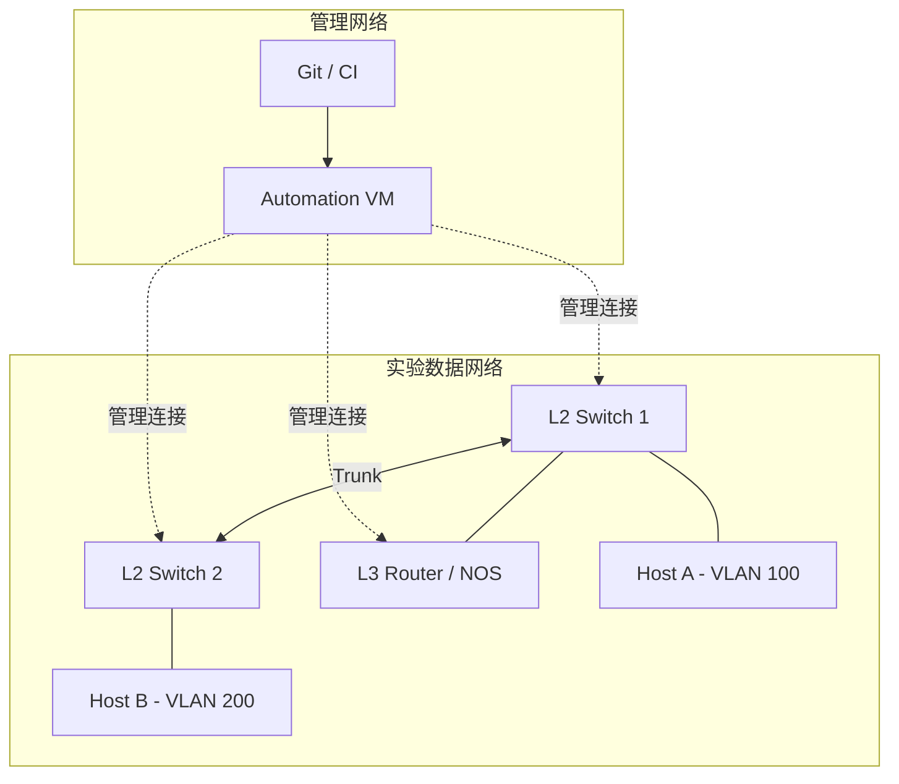

### 变更测试金字塔

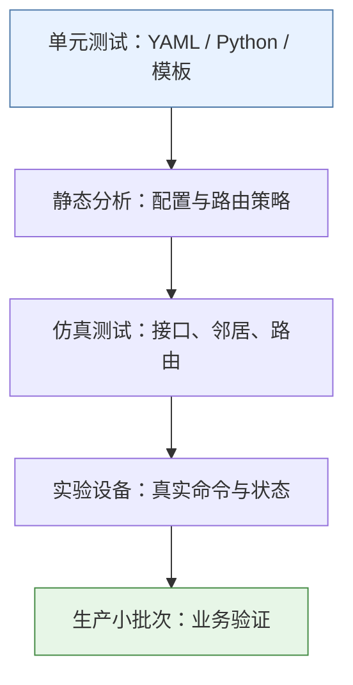


### 9.1 模拟环境选择

| 工具 | 适合场景 | 说明 |
|---|---|---|
| Containerlab | 用容器化网络 NOS 构建可重复拓扑 | 需选择受支持的镜像；部分镜像有授权要求 |
| EVE-NG | 运行虚拟路由器、防火墙和交换机镜像 | 镜像授权、资源和平台兼容性需自行确认 |
| GNS3 | 交互式网络实验 | 适合学习协议与拓扑 |
| 厂商虚拟设备 | 验证特定厂商配置 | 命令与真实设备较接近，但需关注功能限制 |
| Mock / 单元测试 | 测试数据校验和逻辑 | 无需设备，可在 CI 中稳定执行 |

### 9.2 Containerlab 简单拓扑

Containerlab 官方项目及文档：

- 项目：<https://github.com/srl-labs/containerlab>
- 文档：<https://containerlab.dev/>

下面仅展示拓扑结构格式；运行前需要先准备兼容的 NOS 容器镜像，并根据该镜像的要求补齐启动配置。

```yaml
name: netdevops-lab
topology:
  nodes:
    r1:
      kind: linux
      image: alpine:3
    r2:
      kind: linux
      image: alpine:3
  links:
    - endpoints: ["r1:eth1", "r2:eth1"]
```

这个示例使用 Linux 容器验证容器化拓扑的基本概念，不是带有完整路由协议的网络设备实验。Linux 容器中的接口命名、权限和镜像初始化方式可能需要根据环境调整。

### 9.3 从二层到三层的测试清单

**二层：**

- VLAN 是否存在。
- Access 口 VLAN 是否正确。
- Trunk 允许 VLAN 列表是否符合预期。
- LACP 聚合状态是否正常。
- STP 是否出现异常根桥变化或阻塞端口。

**三层：**

- 接口地址与 VRF 是否正确。
- 路由表是否出现预期路由。
- OSPF / BGP 邻居是否达到目标状态。
- 下一跳是否可达。
- 关键网段之间的连通性是否正常。

**服务与安全：**

- DNS、DHCP、NTP 是否可用。
- 管理面 ACL 是否限制了来源。
- SSH / AAA 是否正常。
- 日志和告警是否收到。
- 变更是否引入非预期的默认路由或路由泄漏。

验证脚本应针对“变更前状态”和“变更后预期”编写，而不是只检查命令执行是否返回成功。

---

## 10. 第 7 阶段：NetBox、Nornir、NAPALM 与 API

### 工具协作关系

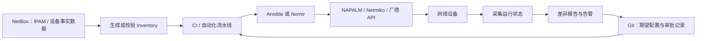

### NetBox 数据如何进入自动化流程

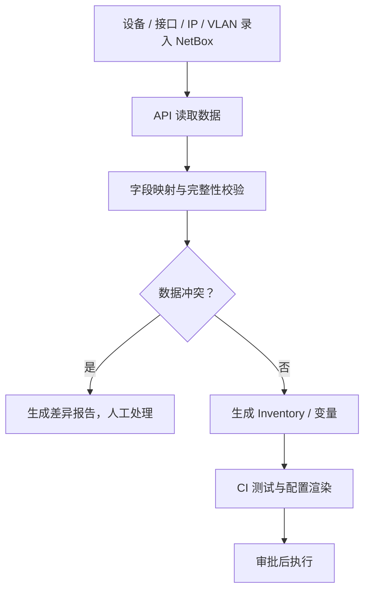


### 10.1 NetBox：网络事实源与 IPAM

NetBox 可用于管理：

- Sites、设备、机柜、设备角色。
- 前缀、IP 地址、VRF、VLAN。
- 设备接口与接口连接。
- 自定义字段、标签和变更相关数据。

官方入口：

- GitHub：<https://github.com/netbox-community/netbox>
- 文档：<https://docs.netbox.dev/>

推荐学习顺序：

1. 手工录入实验设备、接口、VLAN、IP 前缀。
2. 用 API Token 查询设备清单。
3. 编写 Python 脚本把设备清单导出为 JSON。
4. 与 Git 仓库中的声明式数据比较。
5. 先生成差异报告，再考虑自动同步。

NetBox 的数据库记录并不会自动保证现网配置正确。要明确它是事实源、设计源，还是审批后的目标状态源，并制定数据更新责任。

### 10.2 NetBox API 查询示例

先设置环境变量，避免把 Token 写入代码：

```bash
export NETBOX_URL='https://netbox.example.invalid'
read -rsp 'NetBox API token: ' NETBOX_TOKEN
export NETBOX_TOKEN
echo
```

Python 示例 `netbox_devices.py`：

```python
import os
import urllib.request
import json

base = os.environ["NETBOX_URL"].rstrip("/")
token = os.environ["NETBOX_TOKEN"]
url = base + "/api/dcim/devices/?limit=100"

request = urllib.request.Request(
    url,
    headers={
        "Authorization": f"Token {token}",
        "Accept": "application/json",
    },
)

with urllib.request.urlopen(request, timeout=15) as response:
    payload = json.load(response)

for device in payload.get("results", []):
    print({
        "name": device.get("name"),
        "status": device.get("status", {}).get("label"),
        "role": device.get("role", {}).get("name"),
        "site": device.get("site", {}).get("name"),
    })
```

注意：不同 NetBox 版本的字段和 API 行为可能变化；生产使用前应查看目标实例的 API 文档。TLS 证书验证应保持开启，不要通过关闭证书验证来掩盖证书问题。

### 10.3 Nornir：Python 原生任务编排

项目与文档：

- GitHub：<https://github.com/nornir-automation/nornir>
- 文档：<https://nornir.readthedocs.io/>

Nornir 适合希望用 Python 组织设备清单、筛选目标、并行执行任务和处理结果的工程师。学习时先从 inventory、task、result、filter 开始，再集成 Netmiko、NAPALM 或厂商驱动。

### 10.4 NAPALM：统一网络设备操作接口

项目与文档：

- GitHub：<https://github.com/napalm-automation/napalm>
- 文档：<https://napalm.readthedocs.io/>

NAPALM 提供跨平台的常见操作抽象，例如获取事实、读取配置、比较配置和部分平台的配置加载能力。各驱动的能力并不完全一致，必须查看具体平台支持矩阵。

常见工作流：

1. 连接设备并读取事实。
2. 获取运行配置与候选配置。
3. 生成配置差异。
4. 在实验设备验证提交行为。
5. 提交后读取状态并验证。
6. 对失败场景测试回滚能力。

**不要假定所有厂商、所有 NOS 都支持完全一致的候选配置和回滚行为。**

### 10.5 何时选择哪个工具？

- **Ansible**：团队熟悉 YAML，希望快速执行标准化任务和 playbook。
- **Nornir**：需要用 Python 写复杂编排逻辑、筛选和结果处理。
- **NAPALM**：需要统一抽象读取事实、配置差异和设备操作。
- **NetBox**：需要可靠的 IPAM、设备和拓扑数据。
- **Terraform**：主要管理支持良好的云资源或基础设施 API；网络设备 provider 的成熟度因厂商而异。
- **GitLab CI / GitHub Actions**：把检查、测试和受控发布串成流水线。

工具不是越多越好。一个可维护的系统通常先选一个主编排工具，再按明确需求引入其他组件。

---

## 11. 第 8 阶段：生产级 GitOps 流程设计

### 生产变更的安全闸门

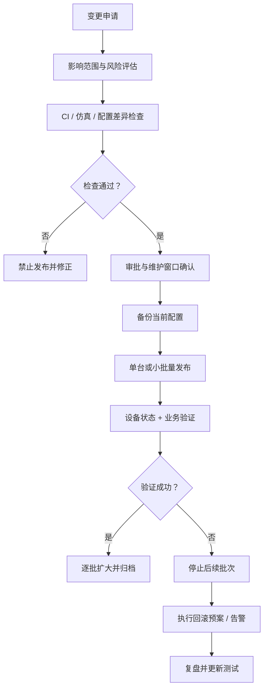

### 变更风险与自动化程度

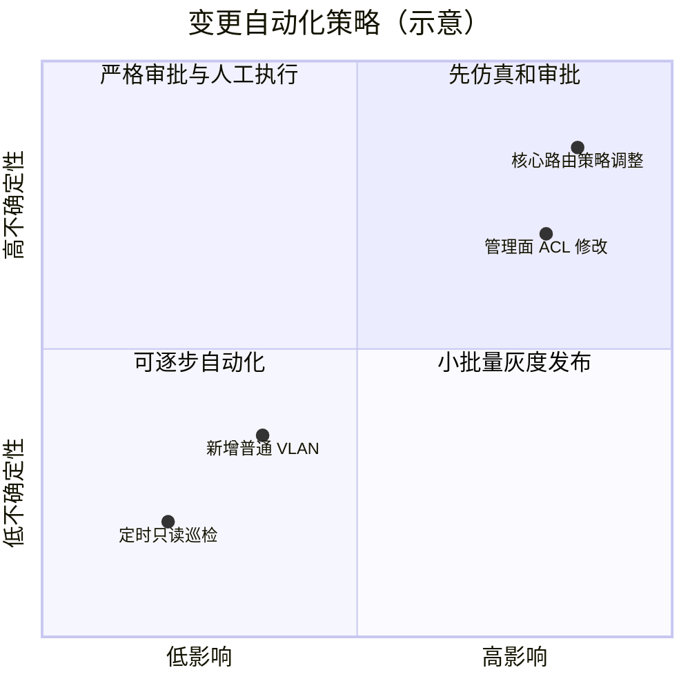

以上风险象限是用于讨论的示意，不是通用风险评分标准。企业应按自身业务和变更制度定义评估方法。


### 11.1 推荐架构

```text
网络工程师
   │
   ▼
Git 仓库（设备数据 / 配置意图 / 模板 / 测试）
   │
   ▼
CI 检查
   ├── YAML / JSON Schema 校验
   ├── IP / VLAN / VRF 冲突检查
   ├── 配置渲染
   ├── 单元测试
   └── 策略与安全检查
   │
   ▼
Merge Request + 审批
   │
   ▼
受控部署 Runner
   ├── 凭据注入
   ├── 备份与配置差异
   ├── 小批量执行
   └── 记录审计日志
   │
   ▼
设备状态验证 + 业务验证
   ├── 成功：报告并结束
   └── 失败：停止扩散、告警、执行回滚预案
```

### 11.2 发布策略

**开发环境：** 可自动执行数据校验、模板渲染和模拟测试。

**实验环境：** 审批可简化，但仍应保存配置、记录变更并测试回滚。

**生产环境：**

- 保护 `main` 分支。
- 至少一名合适的审核人；高风险变更按组织制度增加审批。
- 部署凭据仅在受保护的部署 Job 中可用。
- Runner 网络可达范围应尽量缩小。
- 先对单台或少量设备发布，再逐批扩大。
- 设定超时、失败阈值和停止条件。
- 变更前后保存状态证据。
- 维护紧急变更流程与审计记录。

### 11.3 漂移检测

可定期执行只读巡检：

1. 从设备采集运行状态。
2. 与 NetBox / Git 中的期望数据比较。
3. 分类差异：批准的临时变更、未授权变更、数据过期、自动化误报。
4. 生成报告或工单。
5. 经审批后修正，不要对所有差异无条件自动覆盖。

建议先做“只报告、不自动修复”的模式，观察误报率和数据质量后再考虑自动修复。

---

## 12. 安全、回滚与故障排查

### 失败时的处理路径

```mermaid
flowchart TD
    A[自动化任务失败或验证异常] --> B[冻结后续批次]
    B --> C[确认管理面仍可达]
    C --> D{业务是否受影响？}
    D -- 否 --> E[保存日志并分析原因]
    D -- 是 --> F[按审批预案恢复配置]
    F --> G[验证关键业务与协议状态]
    G --> H[通知相关负责人]
    E --> I[修复测试 / 数据 / 模板]
    H --> I
    I --> J[在实验环境复测后再发布]
```

### 凭据安全边界

```mermaid
flowchart LR
    DEV[开发者电脑] -->|提交代码，不含 Secret| GIT[Git 仓库]
    GIT --> CI[普通 CI：无生产凭据]
    CI --> ART[测试结果 / 差异文件]
    APPROVE[人工审批] --> DEPLOY[受保护部署 Runner]
    VAULT[Secret 管理系统] -->|运行时注入| DEPLOY
    DEPLOY --> NET[限定范围的管理网络]
    NET --> DEVICE[网络设备]
```


### 12.1 必须遵守的安全原则

- 不在 Git 中存放明文密码、私钥、API Token。
- 对 Secret 扫描设置 CI 检查。
- 对部署凭据使用最小权限和短期凭据（若平台支持）。
- 限制自动化账号可访问的设备、命令和网络区域。
- 先备份，再变更。
- 先小范围，再扩大。
- 先验证，再宣布成功。
- 对路由、ACL、管理地址、AAA、核心链路等高风险变更单独审批。
- 为带外管理或控制台访问保留故障恢复路径。
- 不把“Git 回退到旧提交”误认为“设备配置已自动回滚”。

### 12.2 Git 回退与设备回滚的区别

```bash
# 查看历史
git log --oneline

# 撤销一个已经提交的变更，生成新的反向提交
git revert <commit-id>
```

`git revert` 只修改仓库历史，不会自动把交换机恢复到旧配置。设备恢复必须通过已验证的自动化流程、配置快照或设备自身的候选配置机制完成。

### 12.3 常见故障

| 现象 | 常见原因 | 排查方向 |
|---|---|---|
| SSH 连接失败 | 路由、ACL、端口、账号或主机密钥问题 | 从 Runner 测试到管理地址的连通性 |
| Ansible 找不到模块 | collection 未安装或名称错误 | `ansible-galaxy collection list` |
| 设备命令不兼容 | 厂商、NOS 版本或模块不匹配 | 检查模块文档和设备版本 |
| YAML 解析失败 | 缩进、引号、类型错误 | 本地解析与 CI 输出 |
| 模板生成空值 | 变量缺失或字段名拼错 | 使用 `StrictUndefined` 并校验 schema |
| CI 成功但业务异常 | 只验证了任务返回，没有验证网络状态 | 增加路由、邻居、连通性和业务测试 |
| Git 已回退但设备未恢复 | 仓库回退不等于设备回滚 | 执行经过审批和验证的设备恢复流程 |
| 批量发布影响过大 | 并发过高、缺少批次与停止条件 | 限制并发、分批发布、设置失败阈值 |

---

## 13. 互联网公开项目与代码入口

### 开源工具生态图

```mermaid
flowchart TB
    subgraph DATA[网络数据层]
      NB[NetBox]
    end
    subgraph AUTOMATION[自动化执行层]
      ANS[Ansible]
      NOR[Nornir]
      NAP[NAPALM]
      SCR[Scrapli / Netmiko]
    end
    subgraph TEST[测试与验证层]
      BAT[Batfish]
      PY[pyATS / pytest]
      CL[Containerlab]
    end
    NB --> ANS
    NB --> NOR
    ANS --> NAP
    NOR --> SCR
    CL --> PY
    BAT --> CI[CI 流水线]
    PY --> CI
    ANS --> CI
```

这些项目是可组合的工具，不是必须一次性全部安装。先选择最符合当前任务的工具，再按需求扩展。


以下项目是网络自动化领域可公开检索的真实开源项目或官方项目入口。请在使用前查看仓库的 README、许可证、维护状态、支持的平台和版本要求。这里提供的是项目入口与学习方向，不代表每个项目都适用于所有设备。

### 13.1 必学项目

| 项目 | 公开代码 / 文档 | 推荐学习内容 |
|---|---|---|
| Ansible | <https://github.com/ansible/ansible> | Playbook、inventory、变量、角色、幂等性 |
| Ansible Network 文档 | <https://docs.ansible.com/ansible/latest/network/> | 网络连接插件、网络模块和平台支持 |
| Nornir | <https://github.com/nornir-automation/nornir> | Python 任务编排、inventory、并发执行 |
| NAPALM | <https://github.com/napalm-automation/napalm> | 多平台设备事实、配置差异与操作 |
| NetBox | <https://github.com/netbox-community/netbox> | IPAM、设备数据、API 与插件 |
| Containerlab | <https://github.com/srl-labs/containerlab> | 声明式拓扑、可重复实验 |
| Batfish | <https://github.com/batfish/batfish> | 配置分析、路由与网络行为验证 |
| pyATS | <https://github.com/CiscoTestAutomation/pyATS> | 网络测试框架、设备连接和验证 |
| Scrapli | <https://github.com/carlmontanari/scrapli> | Python 网络设备 CLI 自动化 |
| Netmiko | <https://github.com/ktbyers/netmiko> | SSH CLI 自动化和多厂商连接 |

### 13.2 重点案例：Ansible 批量采集

学习路径：

1. 从官方网络模块文档选择目标平台。
2. 使用只读账号连接一台实验设备。
3. 采集版本、型号、接口和邻居信息。
4. 输出结构化 JSON。
5. 将采集结果作为 CI artifact 保存。
6. 对关键字段建立差异检测和告警。

示例代码入口：<https://github.com/ansible/ansible>

不要直接复制不明来源的生产部署 Playbook；先审查任务是否包含 `save`、`reload`、删除、清空、配置覆盖或关闭管理接口等高风险操作。

### 13.3 重点案例：NetBox 作为网络事实源

学习路径：

1. 在实验 NetBox 中录入站点、设备、接口、VLAN、前缀。
2. 使用 API 拉取设备数据。
3. 生成 inventory 或 YAML。
4. 与 Git 声明进行差异比较。
5. 发现冲突时先报告，不自动覆盖真实数据。
6. 明确由哪个系统负责写入，避免双向同步冲突。

代码入口：<https://github.com/netbox-community/netbox>

### 13.4 重点案例：Containerlab + 自动化测试

学习路径：

1. 先启动最小拓扑。
2. 验证节点、链路和管理连接。
3. 在拓扑中部署支持的网络 OS 镜像。
4. 使用 Ansible / Nornir 执行只读采集。
5. 应用一项低风险配置变更。
6. 验证接口、邻居、路由和端到端连通性。
7. 删除拓扑并按同一配置重新部署，验证实验可复现。

代码与文档：

- <https://github.com/srl-labs/containerlab>
- <https://containerlab.dev/>

### 13.5 重点案例：Batfish 做配置前验证

Batfish 能根据受支持的配置格式分析网络行为，例如路由可达性、ACL 影响和部分配置问题。它不等同于对真实设备运行所有协议状态的完整仿真。

- 项目：<https://github.com/batfish/batfish>
- 文档：<https://batfish.readthedocs.io/>

建议先使用官方示例数据集跑通，再把自有实验配置导入。验证结果应与真实设备测试结合，不要只依赖静态分析。

### 13.6 如何评估 GitHub 项目

查看一个项目时，至少检查：

- 最近提交时间和发布版本。
- Open Issues / Pull Requests。
- 支持的 Python、Ansible、NOS 版本。
- LICENSE 是否允许预期用途。
- 是否有测试、CI 和安全策略。
- 示例是否适配当前版本。
- 是否存在破坏性命令、默认凭据或关闭验证的代码。

---

## 14. 毕业实战项目

### 毕业项目端到端架构

```mermaid
flowchart LR
    E[工程师提交 VLAN 200] --> G[Git 分支 / MR]
    G --> CI[数据校验 + pytest + 渲染]
    CI --> DIFF[生成配置差异]
    DIFF --> REV[网络负责人审核]
    REV -->|批准| DEP[实验设备部署]
    REV -->|退回| E
    DEP --> VAL[验证 VLAN / Trunk / 连通性]
    VAL -->|成功| LOG[归档报告与提交 ID]
    VAL -->|失败| RB[停止批次 / 回滚 / 告警]
    RB --> LOG
```

### 毕业项目验收路径

```mermaid
flowchart TD
    A[基础：数据可校验] --> B[模板：配置可生成]
    B --> C[CI：每次提交自动测试]
    C --> D[实验：设备可受控变更]
    D --> E[验证：能判断成功与失败]
    E --> F[恢复：回滚经过测试]
    F --> G[治理：审批、权限、审计齐全]
```


### 项目名称：基于 Git 的园区网 VLAN 变更与合规检查平台

**目标场景：** 一个园区有两台接入交换机和一台三层交换机。网络工程师通过 Git 提交新增 VLAN 的申请，CI 自动校验 VLAN ID 和命名规则、渲染配置并执行测试；审核通过后，由部署人员在实验环境发布并验证。

### 14.1 功能需求

- 设备清单 YAML。
- VLAN / 接口意图 YAML。
- 数据格式与冲突检查。
- Jinja2 配置渲染。
- CI 自动测试。
- 变更差异报告。
- 配置备份。
- 小批量部署。
- 部署后验证。
- 失败停止与回滚手册。
- 每次变更的审计记录。

### 14.2 验收标准

| 项目 | 验收要求 |
|---|---|
| 数据校验 | 重复 VLAN ID、非法 ID、缺失设备字段时测试失败 |
| 版本控制 | 所有配置意图变更有提交记录 |
| CI | 提交后自动执行检查与测试 |
| 配置生成 | 从数据文件生成目标平台配置 |
| 安全 | Git 中不存在明文生产凭据 |
| 发布 | 默认不自动修改生产设备 |
| 验证 | 变更后检查 VLAN、接口、路由或邻居状态 |
| 回滚 | 有经过实验验证的设备恢复流程 |
| 审计 | 可追溯提交、审批、目标设备和执行结果 |

### 14.3 进阶扩展

完成基础版本后，再逐步加入：

1. NetBox API 生成 inventory。
2. Nornir 批量采集并并行执行只读任务。
3. NAPALM / 厂商模块生成配置差异。
4. Batfish 静态分析。
5. Secret scanning。
6. Prometheus / Grafana 或现有监控平台的发布后观察。
7. 工单系统关联变更申请。
8. 定时 drift 检测和差异报告。
9. 按设备角色、站点、业务重要性进行分批发布。
10. 在实验环境验证自动回滚，再评估生产适用性。

### 14.4 最终交付物

完成后，仓库至少包含：

- `README.md`：架构、依赖、使用方法、风险说明。
- `data/`：设备与配置意图。
- `templates/`：配置模板。
- `playbooks/` 或 Python 任务：采集、部署和验证。
- `tests/`：数据与策略测试。
- `.gitlab-ci.yml` 或 GitHub Actions workflow。
- `reports/`：测试结果与差异报告（注意敏感信息脱敏）。
- `docs/change-runbook.md`：变更、验证、停止与回滚步骤。
- `docs/security.md`：凭据、权限、审计和 Runner 安全说明。

---

## 15. 常用命令速查

### Git

```bash
git status
git diff
git diff --staged
git switch -c feature/my-change
git add .
git commit -m "feat: add VLAN 200"
git log --oneline --graph
git revert <commit-id>
```

### Python

```bash
python3 -m venv .venv
source .venv/bin/activate
pip install pyyaml jinja2 pytest
python check_yaml.py data/site.yml
python render_vlans.py
pytest -q
```

### Ansible

```bash
ansible --version
ansible-galaxy collection list
ansible-inventory -i inventory/lab.yml --graph
ansible lab_switches -i inventory/lab.yml --list-hosts
ansible-playbook -i inventory/lab.yml playbooks/collect.yml --limit sw1
```

### 安全发布检查清单

```text
[ ] 变更有明确目标和负责人
[ ] 已确认影响设备、业务和维护窗口
[ ] Git diff 已审查
[ ] 数据、模板和策略测试通过
[ ] 已备份当前配置
[ ] 已确认带外管理或恢复路径
[ ] 先在单台 / 小批量设备执行
[ ] 已验证设备状态和业务连通性
[ ] 失败时已停止后续批次
[ ] 回滚步骤可执行且经过验证
[ ] 审计记录与结果报告已保存
```

---

## 参考资源

- Git 文档：<https://git-scm.com/doc>
- Python 文档：<https://docs.python.org/3/>
- Ansible 文档：<https://docs.ansible.com/>
- Ansible Network 文档：<https://docs.ansible.com/ansible/latest/network/>
- GitLab CI/CD 文档：<https://docs.gitlab.com/ee/ci/>
- GitHub Actions 文档：<https://docs.github.com/actions>
- Jinja 文档：<https://jinja.palletsprojects.com/>
- NetBox 文档：<https://docs.netbox.dev/>
- Nornir 文档：<https://nornir.readthedocs.io/>
- NAPALM 文档：<https://napalm.readthedocs.io/>
- Containerlab 文档：<https://containerlab.dev/>
- Batfish 文档：<https://batfish.readthedocs.io/>
- pyATS：<https://developer.cisco.com/docs/pyats/>
- Scrapli：<https://carlmontanari.github.io/scrapli/>
- Netmiko：<https://github.com/ktbyers/netmiko>

> 学习原则：先只读采集，再生成配置；先模拟测试，再实验设备；先小范围发布，再扩大范围。把安全、验证、审计和回滚作为自动化项目的一部分，而不是上线后再补。
